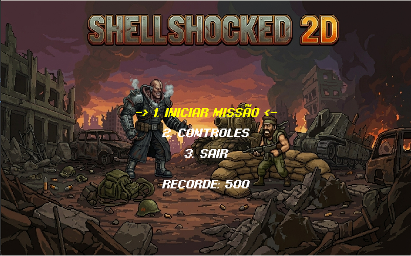
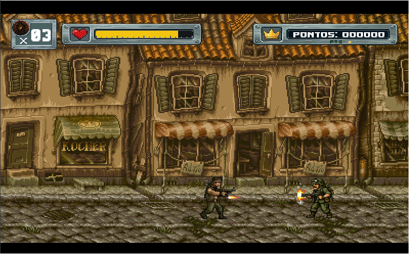
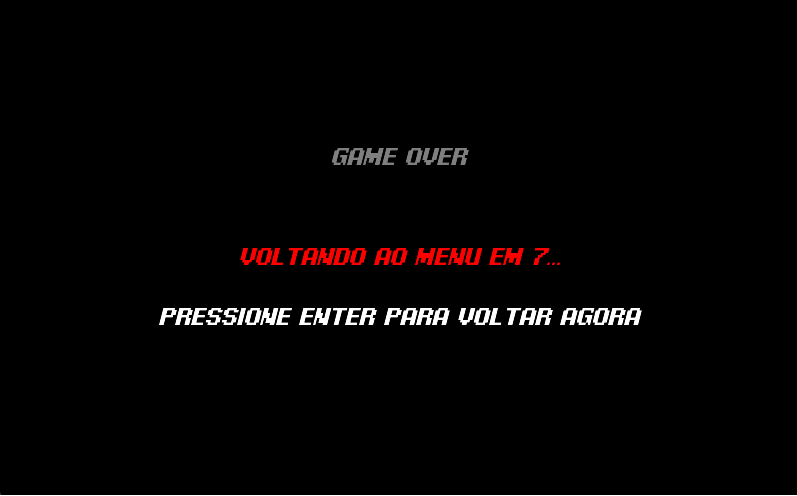
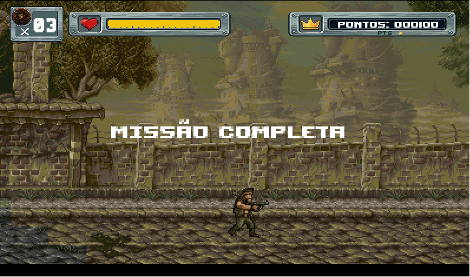

# SHELLSHOCKED 2D

> Jogo de plataforma 2D no estilo arcade/run-and-gun desenvolvido em Java com LibGDX para a disciplina de Programação Orientada a Objetos — IFPB Campus Esperança, 2026.1.

---

## Sumário

- [Descrição do projeto](#descrição-do-projeto)
- [Estrutura do sistema](#estrutura-do-sistema)
- [Funcionalidades principais](#funcionalidades-principais)
- [Requisitos e configuração](#requisitos-e-configuração)
- [Como executar](#como-executar)
- [Conceitos de OO aplicados](#conceitos-de-oo-aplicados)
- [Persistência de dados](#persistência-de-dados)
- [Screenshots](#screenshots)

---

## Descrição do projeto

Run and Shoot 2D é um jogo de plataforma side-scrolling com combate, no estilo Metal Slug. O jogador controla um soldado que deve atravessar um cenário eliminando inimigos — soldados rebeldes e um chefão — para completar a missão. O jogo possui sistema de vidas, pontuação, HUD personalizado, efeitos sonoros e persistência de recorde entre sessões.

---

## Estrutura do sistema

O projeto é organizado em pacotes por responsabilidade:

```
com.Badlogic.runandshoot2d
├── audio
│   └── GerenciadorAudio        — controla toda a trilha sonora e SFX do jogo
├── dados
│   ├── DadosSalvos             — POJO com os dados persistidos (recorde, volumes)
│   └── GerenciadorSave         — leitura e escrita via LibGDX Preferences (JSON)
├── jogo
│   └── RnsJogo                 — ponto de entrada, inicializa recursos compartilhados
├── objetos
│   ├── ObjetoJogo              — classe abstrata base para todo objeto do mundo
│   ├── Obstaculo               — obstáculo estático com colisão (chão, plataforma, barril)
│   ├── Projetil                — projétil com alcance máximo e lógica de destruição
│   └── GerenciadorFisica       — resolve colisões AABB entre jogador/inimigos e obstáculos
└── personagens
    ├── Jogador                 — movimentação, animação, sistema de HP e invulnerabilidade
    ├── Inimigo                 — classe abstrata com IA de patrulha e visão compartilhada
    ├── SoldadoRebelde          — inimigo comum com máquina de estados de animação
    └── Chefao                  — chefão com animações próprias, herdando a IA do Inimigo
telas
    ├── TelaMenuPrincipal       — menu navegável com seleção por teclado e exibição de recorde
    ├── TelaDeJogo              — loop principal: atualização, física, colisões, renderização
    ├── TelaDeControle          — tela com os controles do teclado
    ├── GamerOver               — tela de fim de jogo com contador regressivo
    └── Hud                     — sobreposição de interface (vida, pontuação, vidas)
```

### Diagrama de classes simplificado

```
ObjetoJogo (abstract)
├── Obstaculo
├── Projetil
├── Jogador
└── Inimigo (abstract)
    ├── SoldadoRebelde
    └── Chefao

Game (LibGDX)
└── RnsJogo
    ├── GerenciadorAudio
    └── GerenciadorSave ──── DadosSalvos

ScreenAdapter (LibGDX)
├── TelaMenuPrincipal
├── TelaDeJogo ──── GerenciadorFisica, Hud, Jogador, Inimigo[]
├── TelaDeControle
└── GamerOver
```

---

## Funcionalidades principais

### Menu Principal
- Navegação entre opções com W/S ou setas do teclado
- Opções: Iniciar Missão, Controles e Sair
- Exibição do melhor recorde salvo da sessão anterior

### Tela de Controles
- Lista completa dos controles do teclado
- Retorno ao menu com ESPAÇO

### Tela de Jogo
- Cenário side-scrolling carregado via Tiled Map (`.tmx`)
- Câmera que acompanha o jogador com limites nas bordas do mapa
- Sistema de física com gravidade, pulo e colisão AABB
- Jogador com 3 vidas; ao perder todas, vai para Game Over
- Sistema de pontuação (+100 pontos por inimigo eliminado)
- HUD com barra de vida, contador de vidas e pontuação formatada
- Inimigos com patrulha automática e IA de avistamento com raio de visão
- Dois tipos de inimigos: Soldado Rebelde (comum) e Chefão (boss)
- Sistema de projéteis para o jogador e para os inimigos
- Sons de tiro distintos por arma e passos sincronizados com o movimento
- Tela de "Missão Completa" ao derrotar o chefão

### Game Over
- Exibe contador regressivo de 9 segundos
- Permite retorno imediato ao menu com ENTER

### Persistência
- Recorde máximo salvo automaticamente ao terminar partida (vitória ou derrota)
- Dados mantidos entre execuções do programa

---

## Requisitos e configuração

| Item | Versão recomendada |
|---|---|
| Java | 17 ou superior |
| LibGDX | 1.12.x (incluído no JAR) |
| Sistema operacional | Windows, Linux ou macOS |

Nenhuma instalação adicional é necessária. O JAR já contém todas as dependências.

---

## Como executar

### Via JAR (recomendado)

1. Certifique-se de ter o Java instalado (`java -version`).
2. Coloque o arquivo `Jogo2DRunAndShoot.jar` e a pasta `recursos/` no mesmo diretório.
3. Execute:

```bash
java -jar Jogo2DRunAndShoot.jar
```

### Via IDE (para desenvolvimento)

1. Clone o repositório:

```bash
git clone https://github.com/<seu-usuario>/Jogo2DRunAndShoot.git
cd Jogo2DRunAndShoot
```

2. Abra o projeto com IntelliJ IDEA ou outra IDE com suporte a Gradle.
3. Execute a classe `Lwjgl3Launcher` localizada em:

```
lwjgl3/src/main/java/com/Badlogic/RunAndShoot/lwjgl3/Lwjgl3Launcher.java
```

### Controles

| Tecla | Ação |
|---|---|
| A / D | Mover para esquerda / direita |
| W | Pular |
| F | Atirar |
| ENTER | Confirmar / avançar |
| ESPAÇO | Voltar ao menu |

---

## Conceitos de OO aplicados

## Padrões de projeto aplicados

### Facade — `GerenciadorAudio`
Esconde a complexidade de gerenciar múltiplos objetos `Music` e `Sound`
da LibGDX atrás de uma interface simples. As telas não precisam saber
quantas músicas existem nem como o loop é configurado — chamam apenas
`tocarMenu()`, `tocarGameplay()` ou `tocarGameOver()`.

### Template Method — `ObjetoJogo` e `Inimigo`
`ObjetoJogo` define a estrutura comum a todo objeto do mundo (posição,
hitbox, draw) e declara `update()` como abstrato. `Inimigo` segue o mesmo
padrão: implementa a IA de patrulha e física em seu próprio `update()`,
que as subclasses estendem via `super.update(delta)` antes de adicionar
lógica de animação própria.

### State — `SoldadoRebelde` e `Chefao`
Cada inimigo mantém um enum de estados (`ANDANDO`, `PARADO`, `ATIRANDO`,
`MORRENDO`) com transições explícitas e timer de animação resetado apenas
na mudança de estado. Isso evita que animações comecem no meio e torna o
comportamento visual previsível e fácil de depurar.

### Classes e Encapsulamento
Atributos privados e protegidos com acesso controlado por getters/setters. Exemplo: `Jogador` expõe `getHpAtual()` e `tomarDano()` em vez de permitir acesso direto ao HP.

### Classe Abstrata
`ObjetoJogo` define a estrutura comum a todo objeto do mundo do jogo (posição, velocidade, hitbox, textura) e declara `update(float delta)` como método abstrato, obrigando cada subclasse a implementar sua própria lógica de atualização.

`Inimigo` estende `ObjetoJogo` e centraliza a IA de patrulha e visão, sendo também abstrata para que cada tipo de inimigo defina suas próprias animações.

### Herança
- `SoldadoRebelde` e `Chefao` herdam de `Inimigo`, reutilizando toda a lógica de física e IA e adicionando apenas comportamentos visuais específicos.
- `Obstaculo`, `Projetil` e `Jogador` herdam de `ObjetoJogo`.
- As telas herdam de `ScreenAdapter` da LibGDX.

### Polimorfismo
A lista `Array<Inimigo>` na `TelaDeJogo` armazena tanto `SoldadoRebelde` quanto `Chefao`. O método `inimigo.draw(batch)` chama a implementação correta de cada subclasse sem nenhum `instanceof` no loop de renderização. A verificação com `instanceof` é usada apenas para comportamentos específicos do `Chefao` (tipo de projétil, alcance, ativação de vitória).

### Composição
`TelaDeJogo` compõe `GerenciadorFisica`, `GerenciadorAudio`, `Hud` e listas de objetos ao invés de herdar dessas classes. `RnsJogo` compõe `GerenciadorSave` e `GerenciadorAudio` para disponibilizá-los a todas as telas.

---

## Persistência de dados

O jogo salva e carrega dados entre execuções usando a API `Preferences` da LibGDX, que escreve em disco em formato JSON.

**O que é salvo:** pontuação máxima (recorde), volumes de música e efeitos sonoros.

**Quando é salvo:** automaticamente ao fim de cada partida (vitória ou derrota) e ao fechar o jogo.

**Classe responsável:** `GerenciadorSave`, que serializa/desserializa o objeto `DadosSalvos` via `Json` da LibGDX.

---


## Screenshots

| Menu Principal                          | Tela de Jogo                          |
|-----------------------------------------|---------------------------------------|
|  |  |

| Game Over                              | Missão Completa                             |
|----------------------------------------|---------------------------------------------|
|  |  |
